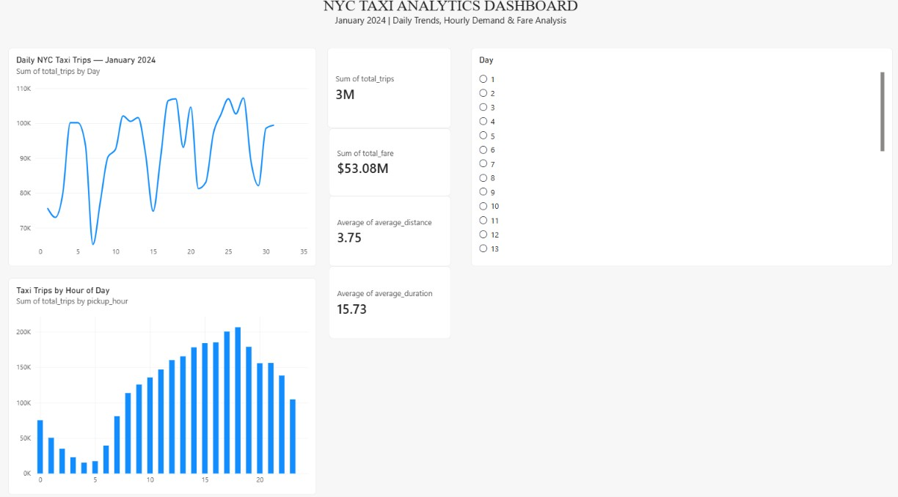

# NYC Taxi Data Engineering Project

An end-to-end Data Engineering project using NYC Yellow Taxi trip data for January 2024. This project demonstrates data extraction, cleaning, validation, analytics, PostgreSQL integration, and interactive visualization with Power BI.

## Project Overview

The project processes NYC taxi trip data to identify daily travel patterns, hourly demand, fare revenue, average trip distance, and trip duration.

## Technologies Used

- **Python** — Data processing and pipeline automation
- **Pandas & PyArrow** — Data manipulation and Parquet processing
- **PostgreSQL** — Analytics storage and SQL queries
- **Power BI** — Interactive dashboard and data visualization
- **SQL** — Data analysis and aggregation
- **Git & GitHub** — Version control and project sharing

## Pipeline Workflow

Extract: Read the raw January 2024 NYC Yellow Taxi Parquet dataset.

Transform: Clean invalid records and derive trip duration, pickup hour, and pickup date.

Analyze: Generate daily and hourly taxi analytics.

Validate: Run data-quality checks on duplicates, missing values, and invalid records.

Load: Load daily and hourly summary data into PostgreSQL.

Log: Record pipeline progress, successful steps, and errors in logs/pipeline.log.

Automate: Use Windows Task Scheduler to run the pipeline automatically.

Visualize: Explore taxi demand and fare trends in Power BI.

## Project Structure

```text
nyc-taxi-data-engineering/
├── data/
│   ├── raw/
│   └── processed/
├── src/
│   ├── extract.py
│   ├── transform.py
│   ├── analytics.py
│   ├── daily_analytics.py
│   ├── data_quality.py
│   ├── load_to_postgres.py
│   ├── load_hourly_to_postgres.py
│   └── run_pipeline.py
├── sql/
│   └── daily_analytics_queries.sql
├── NYC_Taxi_Analytics_Dashboard.pbix
├── PROJECT_NOTES.md
└── README.md
```

## Key Analytics

- Daily taxi trip counts for January 2024
- Hourly taxi demand across 24 hours
- Total fare revenue
- Average trip distance
- Average trip duration
- Data-quality checks on processed records

## Database Tables

- `daily_taxi_analytics` — Daily trip counts, fare totals, average distance, and average duration.
- `hourly_taxi_analytics` — Hourly trip counts, fare totals, average distance, and average duration.

## How to Run

Prerequisites

Python 3.10 or later

PostgreSQL

Power BI Desktop (to open the dashboard)

1. Install dependencies

Run this command from the project root:

pip install pandas pyarrow "psycopg[binary]"

2. Prepare the dataset

Place the January 2024 NYC Yellow Taxi Parquet dataset at:

data/raw/yellow_tripdata_2024-01.parquet

3. Configure PostgreSQL

Create a database named nyc_taxi_db and ensure the required analytics tables are available.

The default local connection settings are:

Host: localhost

Port: 5432

Database: nyc_taxi_db

User: postgres

Update DB_CONFIG in the loader scripts if your settings differ.

For unattended local execution, configure PostgreSQL password authentication using a properly secured PostgreSQL password file (pgpass.conf). Do not put database passwords in source code or commit password files to GitHub.

4. Run the pipeline

From the project root, execute:

python src/run_pipeline.py

The pipeline runs extraction, transformation, analytics, data-quality checks, and PostgreSQL loading. Execution progress and errors are recorded in logs/pipeline.log.

5. View the dashboard

Open NYC_Taxi_Analytics_Dashboard.pbix in Power BI Desktop. Ensure the PostgreSQL connection settings are correct if you refresh the dashboard.

## Learning Outcomes

- Built a Python-based data processing pipeline.
- Worked with Parquet datasets and large tabular data.
- Applied data cleaning and quality validation.
- Generated analytics using Pandas and SQL.
- Loaded aggregated data into PostgreSQL.
- Created a Power BI dashboard connected to a relational database.

## Future Improvements

Process additional months of taxi data.

Add automated tests and more comprehensive data-quality rules.

Deploy the pipeline to a cloud platform.


**Project Type:** Data Engineering  
**Dataset Period:** January 2024  
**Visualization:** Power BI


## Dashboard Preview

 Prajyot@2811
